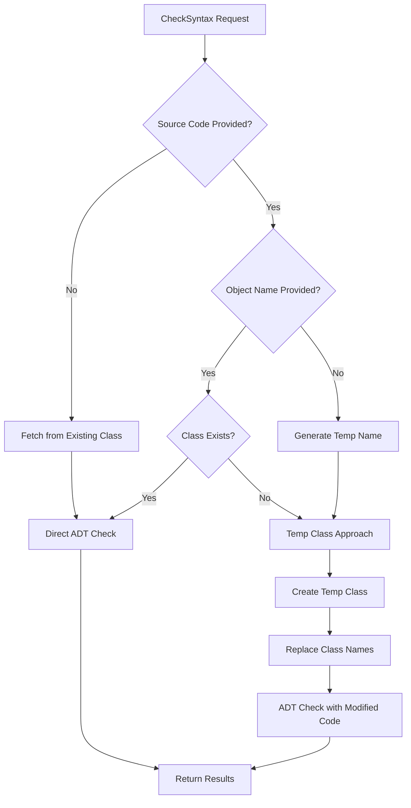

# CheckSyntax Tool

The CheckSyntax tool provides comprehensive ABAP source code syntax validation using SAP ADT (ABAP Development Tools) infrastructure. This tool supports both existing class validation and draft syntax checking for non-existing classes, enabling developers to validate code quality at any stage of development.

## Features

- **Draft Syntax Checking**: Validate ABAP code for non-existing classes using temporary class creation
- **Existing Class Validation**: Direct syntax checking of existing classes with automatic source code fetching
- **Smart Approach Detection**: Automatically chooses the best validation method based on class existence
- **Temporary Class Management**: Creates and manages temporary classes for draft validation
- **Enhanced XML Parsing**: Robust error extraction from ADT responses with proper line number detection
- **Class Name Replacement**: Automatically adjusts class names in source code to match temporary classes
- **Comprehensive Error Reporting**: Detailed syntax errors with line numbers, error messages, and severity levels
- **Multiple Object Type Support**: Works with Classes, Programs, Function Modules, Interfaces, and other ABAP objects
- **Flexible Cleanup Options**: Configurable temporary class cleanup (can be disabled for debugging)

## Usage Scenarios

### 1. Draft Syntax Check (Non-Existing Classes) - NEW!

**Perfect for validating code before class creation:**

```json
{
  "source_code": "CLASS zcl_new_class DEFINITION\n  PUBLIC\n  FINAL\n  CREATE PUBLIC .\n\n  PUBLIC SECTION.\n    METHODS: process_data RETURNING VALUE(rv_result) TYPE string.\n\nENDCLASS.\n\nCLASS zcl_new_class IMPLEMENTATION.\n  METHOD process_data.\n    rv_result = abap_fal.\n  ENDMETHOD.\nENDCLASS.",
  "object_name": "zcl_new_class"
}
```

**What happens:**
1. System detects class doesn't exist
2. Creates temporary class (e.g., `ZTEMP_SYNTAX_12345678`)
3. Replaces class names in source code to match temp class
4. Performs ADT syntax check
5. Returns real syntax errors
6. Leaves temp class in system for debugging (configurable)

### 2. Existing Class Validation (Optimized)

```json
{
  "object_name": "ZCL_EXISTING_CLASS"
}
```
*Automatically fetches source code and validates existing class.*

### 3. Existing Class with Custom Source Code

```json
{
  "source_code": "CLASS zcl_existing DEFINITION...",
  "object_name": "ZCL_EXISTING_CLASS"
}
```
*Validates provided source code against existing class using direct ADT approach.*

### 4. Source Code Only (Auto-Generated Class Name)

```json
{
  "source_code": "CLASS zcl_example DEFINITION PUBLIC.\n  PUBLIC SECTION.\n    METHODS: hello_world.\nENDCLASS."
}
```
*Generates temporary class name automatically for validation.*

## Parameters

| Parameter | Type | Required | Description |
|-----------|------|----------|-------------|
| `source_code` | string | Optional* | ABAP source code to check for syntax errors |
| `object_name` | string | Optional* | Name of the ABAP object (existing or proposed) |
| `object_type` | string | No | ABAP object type (CLAS, PROG, FUGR, etc.) - auto-detected if not provided |

*At least one of `source_code` or `object_name` must be provided.

## Validation Approaches

The tool intelligently selects the best validation approach:

### 1. Direct ADT Approach
- **Used for**: Existing classes
- **Method**: Direct ADT checkruns API call
- **Benefits**: Fast, accurate, uses real class context
- **Indicators**: `"tempClassUsed": false`, `"approach": "direct_adt_api"`

### 2. Temporary Class Approach
- **Used for**: Non-existing classes (draft validation)
- **Method**: Creates temp class → ADT check → Optional cleanup
- **Benefits**: Real syntax validation for draft code
- **Indicators**: `"tempClassUsed": true`, `"approach": "temp_class"`

## Response Format

```json
{
  "syntaxCheck": {
    "status": "success|warning|error",
    "errors": [
      {
        "type": "E",
        "message": "The field \"ABAP_FAL\" is unknown, but there is a field with the similar name \"ABAP_FALSE\".",
        "severity": "error",
        "line": 13
      }
    ],
    "warnings": [],
    "info": [],
    "summary": {
      "totalIssues": 1,
      "errorCount": 1,
      "warningCount": 0,
      "infoCount": 0
    }
  },
  "rawAdtResponse": "<?xml version=\"1.0\" encoding=\"utf-8\"?>...",
  "requestInfo": {
    "objectName": "zcl_new_class",
    "objectType": "CLAS",
    "sourceMethod": "provided",
    "classExists": false,
    "tempClassUsed": true,
    "tempClassName": "ZTEMP_SYNTAX_12345678",
    "adtEndpoint": "Temp class + ADT checkruns API",
    "method": "temp_class_adt_checkruns",
    "timestamp": "2026-01-26T11:40:18.101Z",
    "approach": "temp_class"
  }
}
```

### Enhanced Response Fields

- **sourceMethod**: How source code was obtained:
  - `provided`: Source code provided in request
  - `fetched`: Auto-fetched from existing class
  - `generated_name`: Auto-generated object name

- **classExists**: Boolean indicating if the specified class exists
- **tempClassUsed**: Boolean indicating if temporary class approach was used
- **tempClassName**: Name of temporary class (e.g., `ZTEMP_SYNTAX_27427107`)
- **approach**: Validation method used (`direct_adt_api` or `temp_class`)
- **adtEndpoint**: Description of ADT endpoint approach used
- **method**: Technical method identifier

## Development Workflow Examples

### Complete Draft-to-Production Workflow

```javascript
// 1. Draft Syntax Check
const draftCheck = await use_mcp_tool({
  server_name: "mcp-abap-adt-1",
  tool_name: "CheckSyntax",
  arguments: {
    source_code: myDraftCode,
    object_name: "ZCL_NEW_CLASS"
  }
});

if (draftCheck.syntaxCheck.status === "success") {
  // 2. Create the actual class
  const createResult = await use_mcp_tool({
    server_name: "mcp-abap-adt-1",
    tool_name: "CreateLocalClass",
    arguments: {
      class_name: "ZCL_NEW_CLASS",
      source_code: myDraftCode,
      description: "New class validated with draft syntax check"
    }
  });

  // 3. Final verification
  const finalCheck = await use_mcp_tool({
    server_name: "mcp-abap-adt-1",
    tool_name: "CheckSyntax",
    arguments: {
      object_name: "ZCL_NEW_CLASS"
    }
  });
}
```

### Iterative Development Workflow

```javascript
// Fix code iteratively using draft validation
let sourceCode = myInitialCode;
let syntaxResult;

do {
  syntaxResult = await use_mcp_tool({
    server_name: "mcp-abap-adt-1",
    tool_name: "CheckSyntax",
    arguments: {
      source_code: sourceCode,
      object_name: "ZCL_MY_CLASS"
    }
  });

  if (syntaxResult.syntaxCheck.errors.length > 0) {
    console.log("Errors found:", syntaxResult.syntaxCheck.errors);
    sourceCode = fixErrors(sourceCode, syntaxResult.syntaxCheck.errors);
  }
} while (syntaxResult.syntaxCheck.status !== "success");

// Code is now ready for creation
```

## Error Types and Examples

### 1. Syntax Errors
```json
{
  "type": "E",
  "message": "The statement ENDCLASS. is unexpected",
  "severity": "error",
  "line": 45
}
```

### 2. Semantic Errors
```json
{
  "type": "E", 
  "message": "The field \"ABAP_FAL\" is unknown, but there is a field with the similar name \"ABAP_FALSE\".",
  "severity": "error"
}
```

### 3. Type Resolution Errors
```json
{
  "type": "E",
  "message": "Type \"ZCL_UNKNOWN_CLASS\" is unknown.",
  "severity": "error"
}
```

## Temporary Class Management

### Naming Convention
- **Pattern**: `ZTEMP_SYNTAX_XXXXXXXX`
- **XXXXXXXX**: 8-digit timestamp for uniqueness
- **Package**: Always created in `$TMP` (local package)

### Lifecycle
1. **Creation**: Minimal class structure with auto-generated name
2. **Usage**: Modified source code syntax checked against temp class
3. **Persistence**: Temp class left in system for debugging (cleanup disabled)

### Manual Cleanup (If Needed)
```javascript
// Optional: Clean up temp classes manually
const deleteResult = await use_mcp_tool({
  server_name: "mcp-abap-adt-1", 
  tool_name: "DeleteLocalClass",
  arguments: {
    class_name: "ZTEMP_SYNTAX_12345678"
  }
});
```

## Technical Implementation

### Validation Flow



### ADT Integration

**Direct Approach:**
- **Endpoint**: `/sap/bc/adt/checkruns?reporters=abapCheckRun`
- **Method**: POST with XML payload containing source code
- **Content-Type**: `application/vnd.sap.adt.checkobjects+xml`

**Temp Class Approach:**
1. Create class via ADT class creation endpoint
2. Use same checkruns endpoint with modified source
3. Parse results and map back to original code

### XML Response Parsing

Enhanced parsing handles various ADT XML formats:

```xml
<chkrun:checkMessage 
  chkrun:uri="/sap/bc/adt/oo/classes/classname/source/main#start=13,16;end=13,24" 
  chkrun:type="E" 
  chkrun:shortText="The field &quot;ABAP_FAL&quot; is unknown..."
  chkrun:code="MESSAGE(GWR)">
</chkrun:checkMessage>
```

**Extraction Logic:**
- **Error Type**: `chkrun:type` attribute
- **Message**: `chkrun:shortText` with HTML entity decoding
- **Line Numbers**: Parsed from `chkrun:uri` fragment (`#start=line,col`)

## Best Practices

### For Draft Development
1. **Always validate draft code** before creating classes
2. **Use descriptive object names** even for non-existing classes
3. **Fix all syntax errors** before proceeding to class creation
4. **Review temporary class names** in responses for debugging

### For Existing Classes
1. **Use object name only** for simple validation of existing classes
2. **Provide source code** when validating modifications
3. **Check both errors and warnings** for comprehensive quality assurance

### General Recommendations
1. **Combine with unit testing** for complete validation
2. **Use in CI/CD pipelines** for automated quality gates
3. **Review raw ADT responses** for detailed SAP system feedback
4. **Monitor temp class creation** in development systems

## Troubleshooting

### Common Issues

1. **"Resource does not exist" in temp class approach**
   - **Cause**: Timing issues with temp class creation
   - **Solution**: Tool handles this automatically with retries

2. **Class name conflicts in draft validation**
   - **Cause**: Original class name referenced in source code
   - **Solution**: Tool automatically replaces class names

3. **CSRF Token Errors**
   - **Cause**: Authentication/session issues
   - **Solution**: Tool handles token management automatically

4. **Temp class accumulation**
   - **Cause**: Disabled cleanup functionality
   - **Solution**: Manually clean up with DeleteLocalClass tool

### Debug Information

Response includes comprehensive debug information:
- **tempClassName**: For tracking temporary classes
- **rawAdtResponse**: Full ADT XML response
- **approach**: Validation method used
- **timestamp**: For performance analysis

## Version History

- **v1.0**: Basic syntax checking for existing objects
- **v2.0**: Enhanced error parsing and object type detection  
- **v3.0**: MAJOR RELEASE - Draft Syntax Checking
  - Added temporary class creation for non-existing classes
  - Enhanced XML parsing with proper self-closing tag support
  - Implemented class name replacement in source code
  - Added comprehensive validation approach selection
  - Improved error reporting with line number extraction
  - Added configurable cleanup options
- **v3.1**: Stability improvements and enhanced documentation

## Integration Examples

### With Other MCP Tools

```javascript
// Complete development workflow
const workflow = {
  // 1. Search for similar classes
  search: await use_mcp_tool({
    server_name: "mcp-abap-adt-1",
    tool_name: "SearchObject", 
    arguments: { query: "ZCL_WORKFLOW*" }
  }),

  // 2. Draft syntax check
  syntax: await use_mcp_tool({
    server_name: "mcp-abap-adt-1",
    tool_name: "CheckSyntax",
    arguments: {
      source_code: newClassCode,
      object_name: "ZCL_WORKFLOW_NEW" 
    }
  }),

  // 3. Create class if syntax is valid
  create: syntax.syntaxCheck.status === "success" ? 
    await use_mcp_tool({
      server_name: "mcp-abap-adt-1",
      tool_name: "CreateLocalClass",
      arguments: {
        class_name: "ZCL_WORKFLOW_NEW",
        source_code: newClassCode
      }
    }) : null,

  // 4. Run tests on created class
  test: create ? await use_mcp_tool({
    server_name: "mcp-abap-adt-1", 
    tool_name: "RunClassTests",
    arguments: { class_name: "ZCL_WORKFLOW_NEW" }
  }) : null
};
```

This enhanced CheckSyntax tool now provides comprehensive support for both draft development and existing class validation, making it an essential tool for ABAP development workflows.